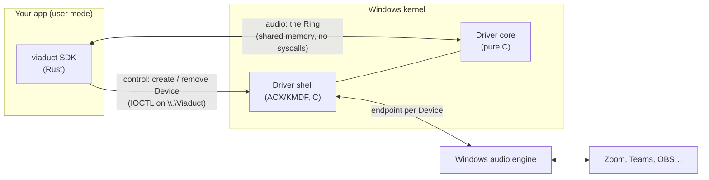

# Viaduct

**Named virtual microphones and speakers that any app can create, and every other app
sees as real audio devices.**

```rust
use viaduct::{Device, Kind};

let mic = Device::builder()
    .name("Agent Mic")
    .kind(Kind::Microphone)
    .format(48_000, 1)
    .create()?;                 // "Microphone (Agent Mic)" appears in Windows, Zoom, Teams…

let mut tx = mic.writer()?;
tx.write(&samples)?;            // whatever you write, Zoom hears
// drop(mic): the device disappears
```

No VB-CABLE, no admin prompt in your app, no reboot. Today Rust desktop apps that need
a virtual mic (soundboards, routers, AI voice agents) tell their users to install a
third-party cable. Viaduct is the missing piece: a kernel driver plus a small Rust SDK
that talks to it over shared memory.

> **Status: v0, Windows only, not released.** The driver, SDK and CLI work end to end
> in a test VM, including a real Zoom call. What's left before the v0 gate is an
> attestation-signed driver installed on a clean Windows 11 with Secure Boot on.
> Nothing is published to crates.io yet (the name `viaduct` is taken there; it gets
> renamed before release).

---

## Contents

- [What it is, and isn't](#what-it-is-and-isnt)
- [Where it stands](#where-it-stands)
- [How it works](#how-it-works)
- [Words we use](#words-we-use)
- [Decisions to keep in mind](#decisions-to-keep-in-mind)
- [Repository layout](#repository-layout)
- [Getting started](#getting-started)
- [Testing the driver (VM only)](#testing-the-driver-vm-only)
- [Command reference](#command-reference)
- [Contributing](#contributing)
- [Not in v0](#not-in-v0)

---

## What it is, and isn't

| Viaduct is | Viaduct is not |
| --- | --- |
| A Windows audio driver that turns "create a device named X" into a real endpoint | A capture library (use `cpal`), a DSP or echo-cancellation library |
| A Rust SDK: create a Device, write to its mic or read from its speaker | A meeting bot or recorder |
| A shared-memory transport between your app and the driver | A GUI app |

Long term the same API is meant to work on macOS and Linux too; v0 is Windows only.

## Where it stands

Measured in a VMware Windows 11 guest (test-signed driver, Driver Verifier on):

| Check | Result |
| --- | --- |
| A Device shows up as an input or output in Windows, Zoom and Sound Recorder, named after the Device | ✅ |
| Removing it (or killing the app) removes the endpoint, no crash, no leaked memory | ✅ |
| Same name, same endpoint every time (Zoom remembers your choice) | ✅ |
| Zoom test call, mic and speaker | ✅ 0 dropouts |
| One hour of streaming | ✅ no drift, no build-up |
| Every CPU core at 100% | ✅ no dropouts |
| 8 Devices from 8 apps at once (the v0 maximum) | ✅ |
| CPU cost per stream | under 0.2% of one core |
| Added latency | ⚠️ ~28 ms (speaker), ~40 ms (mic); the 10 ms target is post-v0 work |
| Attestation-signed install, Secure Boot on | ⏳ the v0 gate, next |

## How it works



1. **The root device.** Windows only runs a driver when a device needs it, and virtual

   hardware has no plug to announce one. So installation creates one permanent
    "always plugged in" device, `Root\Viaduct`. Windows loads `viaduct.sys` for it, and
    the driver opens its control door, `\\.\Viaduct`.
2. **Creating a Device.** The SDK allocates a ring buffer (the **Ring**) in the app's

   memory and sends a create command with the name, kind and the Ring. The driver
    locks the Ring's pages, then adds a child device under the root. Windows turns
    that child into an audio endpoint: "Microphone (Agent Mic)".
3. **Streaming.** No syscalls per buffer. The app writes samples into the Ring and a

   timer in the driver moves 10 ms at a time between the Ring and Windows' audio
    engine. If the app falls behind, the driver plays silence and counts a **Gap**; if
    the Ring is full, the extra is dropped and counted as **Overflow**. Both show up in
    `Device::stats()`.
4. **Removing.** Dropping the `Device` (or the app exiting, or crashing) closes its

   handle, and the driver removes the child, so the endpoint disappears.

The driver is split in two on purpose:

- **The core** (`core/src/`) is plain C with no Windows headers: the Device table, the
name rules, the Ring protocol and format conversion. It's compiled into the driver
unchanged, and into host-side tests, so all of its logic is tested on any PC
without loading a driver.
- **The shell** (`platforms/windows/driver/src/`) is the thin ACX/KMDF layer around it:
devices, streams, the timer and tracing. It's checked in the test VM.

Everything that can live in user space (validation, buffering policy, later drift
correction) lives in the SDK, where a bug can't crash the machine.

## Words we use

| Word | Meaning |
| --- | --- |
| **Device** | A virtual mic or speaker an app created. One name, one kind, one Ring. |
| **Kind** | `Microphone` (app → Windows) or `Speaker` (Windows → app). |
| **Owner** | The app handle that created a Device. When it closes, its Devices go. |
| **Ring** | The shared-memory ring buffer for one Device's audio. 32-bit float, 48 kHz, mono in v0. |
| **Gap** | Frames the driver needed but the Ring didn't have (silence was played). |
| **Overflow** | Frames the app wrote that didn't fit in the Ring (dropped). |
| **Root device** | The one permanent device, `Root\Viaduct`, that makes Windows load the driver. |
| **Endpoint** | What Windows and apps see: "Microphone (Agent Mic)". One per Device. |
| **Core / shell** | The pure-C, host-tested logic / the Windows-specific kernel layer around it. |

## Decisions to keep in mind

The project keeps Architecture Decision Records for each of these; here is what they
mean in practice when you touch the code.

- **ACX on KMDF, kernel in C.** Microsoft's current audio driver model. C, not Rust,
in the kernel for v0: the audio class extensions are C APIs, and a Rust kernel
rewrite waits until the protocol is stable.
- **Pure core, thin shell.** Logic goes in `core/`, testable on the host; the shell only
adapts Windows to it. If you're adding an `if` to the shell, ask whether it belongs
in the core.
- **The app allocates the Ring; the driver locks it.** The driver never trusts it:
every index and size the app can touch is checked, since a hostile app controls
every byte of the Ring.
- **One ABI header, versioned.** `core/include/viaduct_abi.h` is the contract between SDK
and driver. The SDK mirrors it in `crates/viaduct/src/abi.rs`, and a test checks
every constant, size and offset match. Changing it means a version bump.
- **v0 scope is fixed:** 48 kHz, mono, float, at most 8 Devices, names up to 63
characters, case-sensitive. Windows may open the endpoint as float or 16-bit PCM;
the driver converts, the app always sees float.
- **Same name, same endpoint.** A Device's child gets an ID derived from its kind and
name, so Windows reuses the endpoint and keeps the user's settings for it.
- **Any interactive user's app may create a Device, without elevation.** Sandboxed
Store apps may not. Abuse protections are post-v0.
- **Installing is a separate admin step,** done once: `viaduct-cli install`. The SDK
never installs anything and returns `Error::DriverNotInstalled` if the driver isn't
there.
- **Tracing stays in production builds.** ETW (TraceLogging, provider
`Viaduct.Driver`) costs nothing until someone records it.

## Repository layout

```
core/
  include/viaduct_abi.h     the SDK ↔ driver contract (the only shared header)
  src/                      pure C core: Device table, Ring, clock, PCM16 conversion
  tests/                    host tests for the core (Rust harness via bindgen + cc)
crates/
  viaduct/                  the Rust SDK (public API: Device, Writer, Reader, Stats, Error)
  viaduct-cli/              test tool: mic, speaker, measure, install, uninstall
testing/
  fake-driver/              the real C core behind the SDK, in-process, for SDK tests
platforms/windows/
  driver/                   the ACX/KMDF driver: shell sources, viaduct.inf, project
  vm/                       scripts for the test VM (package, install, probe, trace)
  release/                  make-attestation-cab.ps1 (the .cab for Microsoft signing)
target/                     build output (driver, VM package, attestation cab)
```

## Getting started

### Prerequisites (Windows 11 x64)

| Tool | For |
| --- | --- |
| Rust (stable, edition 2024) | SDK, CLI, all tests |
| Visual Studio 2026 (v18) with "Desktop development with C++" and its Clang tools | the C compiler for core tests, and `libclang` for bindgen (`.cargo/config.toml` points at it) |
| Windows Driver Kit 10.0.28000 | building the driver only |
| VMware Workstation Pro (free for personal use) | running the driver only |

You don't need the Driver Kit or a VM to work on the SDK, the CLI or the core.

### Build and test (safe on any PC: nothing is installed or loaded)

```bash
cargo build --workspace
```

```bash
cargo test --workspace
```

This runs the core's C logic, the ABI mirror check and the SDK contract tests against
the fake driver. One test, `windows_without_driver`, expects the driver to be absent,
so it fails on a machine where Viaduct is installed; that's by design.

Formatting, lints and coverage: see [Before you commit](#before-you-commit).

### Build the driver

Use the **64-bit** MSBuild (the 32-bit one picks a validator that can't check x64
drivers):

```bash
"/c/Program Files/Microsoft Visual Studio/18/Community/MSBuild/Current/Bin/amd64/MSBuild.exe" platforms/windows/driver/viaduct.vcxproj -p:Configuration=Release -p:Platform=x64
```

Add `-p:RunCodeAnalysis=true` for Microsoft's driver code analysis. Output goes to
`target/driver/x64/Release/`. Building never signs, installs or loads anything. More in
[platforms/windows/driver/README.md](platforms/windows/driver/README.md).

## Testing the driver (VM only)

> ⚠️ **Never load the driver on your own PC.** A kernel bug crashes the machine,
> and test-signed drivers need test signing on, which weakens Secure Boot (and can
> trip BitLocker and anti-cheat). Every load happens in a VM you can roll back.

The loop:

1. **Host:** build the test package. It builds the driver and CLI, and test-signs them

   with a throwaway certificate that only exists in memory:
2. Copy `target\vm-package` into the guest as `C:\vm-package`.
3. **Guest, once:** `prepare-vm.ps1` turns test signing on (Secure Boot must be off in

   the VM's settings), then reboot. Take a snapshot.
4. **Guest, every build:** go back to that snapshot, then install:
   ```
    powershell -ExecutionPolicy Bypass -File .\install-in-vm.ps1 -Verifier
   ```

    and reboot (Driver Verifier needs it).
5. **Guest:** run `.\viaduct-cli.exe mic "Agent Mic"`. It appears in Settings → Sound;

   record it with Sound Recorder and you hear a tone. Press Enter and it's gone.

Snapshots are the undo button: if the guest crashes, go back and try the next build.

- **Crashes:** the guest writes a small minidump. Read it on the host with
`platforms/windows/vm/analyze-minidump.ps1`, which is deliberately light. Don't open
the full `MEMORY.DMP` with `!analyze -v`: it can fill a 32 GB RAM on host.
- **No live kernel debugger:** with one attached, VMware guests bugcheck at boot
(`NMI_HARDWARE_FAILURE`) on hosts running Windows' own hypervisor. It's a known
VMware issue.
- **Tracing:** `trace-run.ps1 <name> [-Cpu]` in the guest records the driver's events;
`analyze-trace.ps1 <file>.etl` on the host summarises them.

## Command reference

### `viaduct-cli`

| Command | What it does |
| --- | --- |
| `viaduct-cli mic "<name>" [--tone <hz>]` | Creates a mic and streams a sine tone into it (440 Hz by default) until Enter |
| `viaduct-cli speaker "<name>"` | Creates a speaker and shows a level meter of what's played to it |
| `viaduct-cli measure mic\|speaker "<name>" [--seconds 60] [--lead-ms 20]` | Opens the endpoint the way Zoom does (WASAPI) and reports latency, glitches, Gap and Overflow |
| `viaduct-cli install <package folder or viaduct.inf>` | **Admin.** Creates the root device if missing and installs the driver. Safe to repeat. |
| `viaduct-cli uninstall` | **Admin.** Removes the root device, leftover endpoints and the driver package |

### Scripts

| Script | Where | What it does |
| --- | --- | --- |
| `platforms/windows/vm/make-test-package.ps1` | host | Builds and test-signs everything into `target\vm-package` |
| `platforms/windows/release/make-attestation-cab.ps1 -Version a.b.c.d` | host | Builds the release driver and packs the `.cab` for Microsoft's attestation signing (signs nothing itself) |
| `platforms/windows/vm/analyze-minidump.ps1 <dmp>` | host | A crash's bug check and the driver's frames, kept under 1 GB of memory |
| `platforms/windows/vm/analyze-trace.ps1 <etl>` | host | The driver's events and DPC/ISR summary from a recording |
| `prepare-vm.ps1` | guest | Test signing on, small crash dumps, kernel debugging off; refuses outside VMware |
| `install-in-vm.ps1 [-Verifier] [-Signed <folder>]` | guest | Installs the test-signed driver, or with `-Signed` the Microsoft-signed one (needs Secure Boot on) |
| `probe-endpoint.ps1` | guest | Opens each Viaduct audio interface the way Windows' audio service does |
| `trace-run.ps1 <name> [-Cpu]` | guest | Records the driver's ETW events (and CPU/audio with `-Cpu`) until Enter |
| `cpu-load.ps1` | guest | Keeps every core busy, for tests under load |
| `many-mics.ps1` | guest | Runs several `viaduct-cli mic` processes at once |

### Releasing a signed driver

1. `make-attestation-cab.ps1 -Version 0.1.0.0` (raise the version every submission).
2. Sign the `.cab` with the company's EV code-signing certificate.
3. Submit it in Partner Center (Hardware → Submit new hardware), Windows 11 x64.
4. Download the signed files and install them with

   `viaduct-cli install <folder>` on a clean machine, Secure Boot on.

## Contributing

### How work is done here

- **Tests first.** Behaviour lands in small slices: write the failing test, make it
pass, and for anything subtle check that breaking the code breaks the test.
- **Logic in the core, Windows in the shell.** New rules about Devices, names or the
Ring go in `core/src/` with a host test in `core/tests/`. The shell stays thin.
- **The ABI is a contract.** Change `viaduct_abi.h` and `abi.rs` together; the
`abi_mirror` test fails if they drift.
- **Check driver changes against Microsoft's samples** (the ACX samples and SdcaVad in
`Windows-driver-samples`) before taking them to the VM. Most hard-won fixes came
from matching what those samples do.

### Before you commit

Run each check yourself, in this order. Each must finish with no warnings.

```bash
cargo fmt --all -- --check
```

```bash
cargo clippy --workspace --all-targets -- -D warnings
```

```bash
cargo test --workspace
```

If you touched the driver, build it too (warnings are errors there), with Microsoft's
code analysis:

```bash
"/c/Program Files/Microsoft Visual Studio/18/Community/MSBuild/Current/Bin/amd64/MSBuild.exe" platforms/windows/driver/viaduct.vcxproj -p:Configuration=Release -p:Platform=x64 -p:RunCodeAnalysis=true
```

### Coverage

`cargo-llvm-cov` prints a per-file table of the lines, regions and branches the tests
run, **the C core included**: for this the core is compiled with Visual Studio's
clang (`CC`), whose LLVM version must match rustc's (`rustc -vV`). Two tools, once:

```bash
rustup component add llvm-tools-preview
```

```bash
cargo install cargo-llvm-cov --locked
```

Then:

```bash
CC="/c/Program Files/Microsoft Visual Studio/18/Community/VC/Tools/Llvm/x64/bin/clang-cl.exe" cargo llvm-cov --workspace --include-ffi --summary-only --ignore-filename-regex 'viaduct[\\/]src[\\/]windows\.rs|viaduct-cli[\\/]src[\\/](main|measure)\.rs|install[\\/]setup\.rs|testing[\\/]fake-driver'
```

Add `--show-missing-lines` to list the lines each file misses. Left out of the
figures, because they only do something against a live driver, endpoint or machine
setup (their logic was moved into tested modules first; the rest is checked in the
test VM):

| Left out | Why | Where its logic is tested |
| --- | --- | --- |
| `crates/viaduct/src/windows.rs` | The IOCTL transport to the real driver | VM; the not-installed path has a test |
| `crates/viaduct-cli/src/main.rs` | The mic/speaker loops on a live Device | Parsing: `cli.rs` |
| `crates/viaduct-cli/src/measure.rs` | WASAPI streams on a live endpoint | Pairing and statistics: `latency.rs` |
| `crates/viaduct-cli/src/install/setup.rs` | SetupAPI calls that change the machine | INF parsing: `install.rs`; VM for the rest |
| `testing/fake-driver` | Test scaffolding, never shipped | The contract tests it serves |

The lint rules live in the root `Cargo.toml` (`[workspace.lints]`); every crate opts
in with `[lints] workspace = true`. To silence one in a specific place, use
`#[expect(clippy::…, reason = "…")]`, so the reason is written down and the build
tells you when it's no longer needed.

### `unsafe` code

Calling Windows from Rust is always `unsafe`: Windows is C, and Rust can't check the
other side. The rules here:

- keep each `unsafe` block to the call itself, with a `// SAFETY:` comment saying why
it's correct (clippy fails the build without one: `undocumented_unsafe_blocks`);
- wrap it in a safe function or type (handles freed in `Drop`), so callers never see it;
- shared memory with the kernel (`crates/viaduct/src/ring.rs`) is the one place that
deserves the most care; it follows the Ring protocol exactly.

### Style

- Rust: `rustfmt` defaults, clippy clean.
- C: C17, warnings as errors, no floating point in the driver (the core converts audio
with integer arithmetic on the bit patterns), no allocation on the streaming path.
- Comments say *why*, not what. Docs live next to what they describe: this file for
the project, `platforms/windows/driver/README.md` for the driver.

## Not in v0

Deliberately left out, to reach the gate first: other sample rates and channel
counts, loopback devices, renaming a live Device, volume and mute, more than 8
Devices, latency under 10 ms, drift compensation and frame timestamps, installer
self-heal and packaging, macOS and Linux backends, bindings for C, Node, Python and
Swift.

## License

Privately owned.
